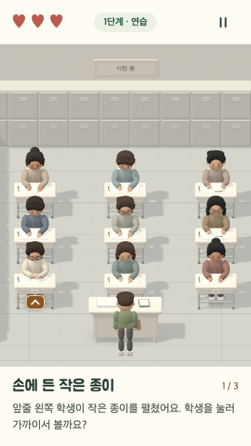
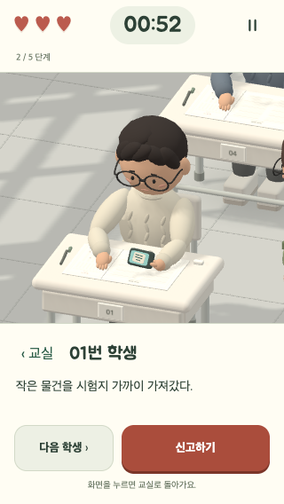
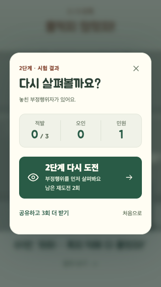
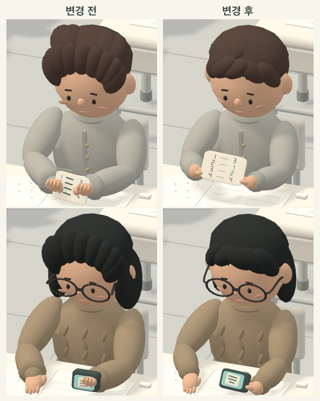

<div align="center">

# 냥이잡기 🐾

**누가 몰래 정답을 보고 있을까요?**

점토 교실에서 학생의 손짓과 소품을 살피는 모바일 3D 시험 감독 게임

### [🎮 지금 플레이하기](https://cat-hunting.vercel.app/)

설치·로그인 없이 브라우저에서 플레이 · 1단계 연습 + 2~5단계 시험

[게임 화면](#게임-화면) · [데이터로 다듬은 게임](#데이터로-다듬은-게임) · [로컬 실행](#로컬-실행) · [개발 문서](docs/README.md)

[](https://cat-hunting.vercel.app/)

<sub>표지는 게임을 위해 생성한 일러스트입니다. 아래는 실제 게임 화면입니다.</sub>

</div>

## 게임 화면

<table>
  <tr>
    <th>① 교실에서 조작 연습</th>
    <th>② 가까이 살펴보고 판단</th>
    <th>③ 실패한 행동을 다시 학습</th>
  </tr>
  <tr>
    <td width="33%"></td>
    <td width="33%"></td>
    <td width="33%"></td>
  </tr>
</table>

2026-11-20~21 Chrome 캡처입니다. 튜토리얼은 실제 시간에 조작했고, 시험 관찰·결과는 검증용으로 시간을 제어했습니다. [캡처별 버전과 조건](docs/playtest/README.md)

## 이렇게 플레이해요

1. **다가가서 관찰하기.** 학생을 누르면 감독관이 책상과 의자를 피해 걸어갑니다.
2. **물건을 보고 판단하기.** 쪽지와 수험표, 소형 카메라와 지우개처럼 닮은 행동을 구별해 신고합니다. 관찰 문장은 정답을 알려주지 않습니다.
3. **손 든 학생도 돌보기.** 답안지를 건네고 커튼을 닫습니다. 오인 신고와 민원으로 생명이 모두 줄거나, 종이 울릴 때 부정행위자가 남으면 실패합니다.

| 단계 | 교실과 시간 | 경험 |
| --- | --- | --- |
| 1 · 튜토리얼 | 학생 9명 · 시간제한 없음 | 쪽지 적발 → 수험표 오인 → 새 답안지 전달 |
| 2 · 첫 시험 | 학생 9명 · 60초 | 연습한 조작으로 직접 감독 |
| 3~5 · 심화 시험 | 학생 12명 · 각 45초 | 짧아지는 단서와 늘어나는 관찰·응대 부담 |

진행은 같은 브라우저에 저장됩니다. 하루 기본 재도전은 3회이며 시험 실패 때만 차감합니다. 공유 성공 응답 또는 링크 복사 후 게임 화면에서 내부 대기를 마치면 3회를 더 받습니다. 튜토리얼은 횟수 없이 반복할 수 있습니다. [자세한 규칙](docs/product/game-design.md)

## 데이터로 다듬은 게임

**2026-11-18~24 운영 데이터 · 11월 25일 GA4 일반 보고서 확인 · 한국 시간 기준**

| 활성 사용자 | 시험 시작 | 시험 결과 확정 | 다시 보기 열기 |
| :---: | :---: | :---: | :---: |
| **407명** | **852회** | **692회** | **301회 · 162명** |

주요 유입 경로는 GeekNews(`news.hada.io`, 활성 사용자 147명), 직접 유입(144명), Threads(111명)였습니다. 경로별 사용자는 중복될 수 있어 합산하지 않습니다. 시험 집계에는 튜토리얼 도입 전 버전과 재도전이 포함됩니다.

### 1. 첫 단계에서 조작과 판단을 연습하기

11월 18~19일의 기존 1단계 시험은 **완료 476판 중 56판에 성공해 성공률이 11.8%였습니다.** 생명 소진이 271판, 미검거가 149판으로, 첫 시험에서 많은 실패가 발생했습니다. 11월 18일의 초기 GA 확인과 사용자 피드백을 계기로 단서 노출 시간을 늘렸고, 학생 수·제한 시간·이동 속도를 조정했습니다.

이후 부정행위 유형을 익히기 어렵다는 피드백을 반영해 11월 20일 **시간제한 없는 1단계 튜토리얼**을 도입했습니다. 실제 교실에서 쪽지를 적발하고, 비슷한 수험표를 잘못 신고해 보고, 손 든 학생에게 답안지를 건넵니다. 첫 시험으로 넘어가기 전에 핵심 조작과 판단을 직접 경험하도록 했습니다.

도입 후 수집된 튜토리얼 시작 사용자는 **32명**, 완료 사용자는 **25명**으로, **완료/시작 사용자 집계 비율은 78.1%입니다.** 후속 실전인 2단계의 완료 판 성공률도 함께 살폈습니다.

| 2단계 시험의 관측 기간 | 성공 / 완료 판 | 성공률 |
| --- | --- | --- |
| 11월 18~19일 | 14 / 71판 | 19.7% |
| 11월 21~24일 | 7 / 22판 | 31.8% |

**튜토리얼 완료 비율과 과거 시험 성공률은 서로 다른 지표입니다.** 위 사용자 집계는 순서를 연결한 전환 퍼널이 아니며, 2단계 비교도 표본이 작고 난이도·카메라·다시 보기 변경이 함께 적용됐습니다. 첫 단계 전환 개선을 위해 도입한 과정과 현재 관측치이며, 튜토리얼만의 효과가 입증된 것은 아닙니다. 다음 확인은 같은 사용자의 `tutorial_start → tutorial_complete → level_start(exam_2)` 진행입니다.

### 2. 실패한 판에서 다음 판을 배울 수 있게

놓친 부정행위를 실제 학생 모델과 애니메이션으로 다시 관찰하도록 만들었습니다. 2단계에서는 **다시 도전 → 방금 판의 부정행위 관찰 → 새 시험**으로 이어집니다. 정답은 실패한 뒤에 보여주고, 다음 판은 새 배치로 시작합니다.

기간 내 다시 보기는 **162명이 301회** 열었습니다. 실제로 사용되는 학습 경로임을 확인했고, `previous_review`로 같은 페이지의 직전 판 다시 보기 여부와 다음 판 결과를 연결해 수집합니다. 열람 횟수만으로 학습 효과를 판단하지 않고, 재도전 시작과 다음 판 성공을 함께 확인합니다.

### 3. 소품마다 다른 난이도를 수치와 화면으로 살피기

이전 1단계 시험에서 소품별 적발 비율은 다음과 같았습니다. 분모는 완료 판에 배치된 범인 수입니다. 실제 관찰 횟수나 초심자의 식별 정확도는 아니지만, 소품마다 경험이 다르다는 점을 살필 수 있습니다.

| 소품 | 적발 / 범인 배치 | 적발 비율 |
| --- | --- | --- |
| 안경 | 108 / 147 | **73.5%** |
| 펜 | 37 / 167 | **22.2%** |
| 쪽지 | 39 / 162 | **24.1%** |

사용자가 제보한 손의 가림 문제도 함께 검토했습니다. 종이 아래 모서리를 잡고 기기 테두리를 집도록 손과 소품의 접점을 고쳐 글씨와 화면이 드러나게 했습니다. 정상 행동과 부정행위는 같은 손목 동선을 유지합니다. 이 수정의 적발률 개선 효과는 아직 분리해 측정하지 않았습니다.

<p align="center">
  
</p>

수치는 운영자·재방문자·여러 배포 버전을 포함한 관측입니다. **집계 원본 값, 계산식, 비교 기간과 한계**는 [11월 25일 분석 기록](docs/quality/analytics-2026-11-25.md)에, 이벤트 정의는 [플레이 분석](docs/engineering/analytics.md)에 남겼습니다.

## 구현

**JavaScript ES modules · Three.js · Vite · Playwright · GA4 · Vercel**

- Three.js로 교실·학생·소품과 행동을 렌더링하고, 가구를 피하는 감독관 이동을 연결합니다.
- 게임 규칙(`Exam`)과 3D 연출(`Room`)을 나눠 단계·저장·판정과 애니메이션을 검증합니다.
- 모바일 세로 화면을 중심으로 구성하고, 데스크톱에서도 중앙의 세로 화면으로 플레이합니다.
- GA4에 시작·종료 사유·재도전·소품별 성과와 배포 버전을 기록합니다. 개발·미리보기에서는 운영 분석을 기본 비활성화합니다.

## 로컬 실행

```sh
npm ci
npm run dev
```

[http://127.0.0.1:5173](http://127.0.0.1:5173)에서 실행합니다. WebGL 2 지원 브라우저가 필요합니다. 같은 Wi-Fi의 휴대폰에서는 `npm run phone` 실행 후 터미널의 Network 주소로 접속합니다.

```sh
npm test
npm run build
```

개발 서버를 켠 뒤 `npm run test:browser`, `npm run test:campaign`, `npm run test:assets`로 터치·진행·소품을 검사합니다. 서버 주소와 브라우저 선택은 [개발 안내](docs/engineering/development.md)를 따릅니다. 자동 검사와 실제 휴대폰·초심자 플레이 검증의 범위는 [현재 검증](docs/quality/current-review.md)에서 구분합니다.

## 더 읽기

| 궁금한 내용 | 문서 |
| --- | --- |
| 현재 방향과 문서 지도 | [문서 홈](docs/README.md) |
| 규칙과 단계별 밸런스 | [게임 기획](docs/product/game-design.md) |
| 손·소품·감정과 행동 표현 | [아트 방향](docs/product/art-direction.md) |
| 사용자 피드백과 변경 이유 | [결정 이력](docs/decisions/conversation-log.md) |
| 운영 데이터와 측정 정의 | [최근 분석](docs/quality/analytics-2026-11-25.md) · [플레이 분석](docs/engineering/analytics.md) |
| 실행·검증·배포 | [개발 안내](docs/engineering/development.md) · [공유와 배포](docs/engineering/sharing-and-deployment.md) |
| 아직 확인할 경험 | [미검증 항목](docs/quality/open-questions.md) |

만든 사람 **후추** · [hodooo153@gmail.com](mailto:hodooo153@gmail.com)

표지 일러스트는 프로젝트용으로 생성했습니다. Jua 글꼴은 [SIL Open Font License](public/fonts/OFL-Jua.txt)로 배포됩니다.
