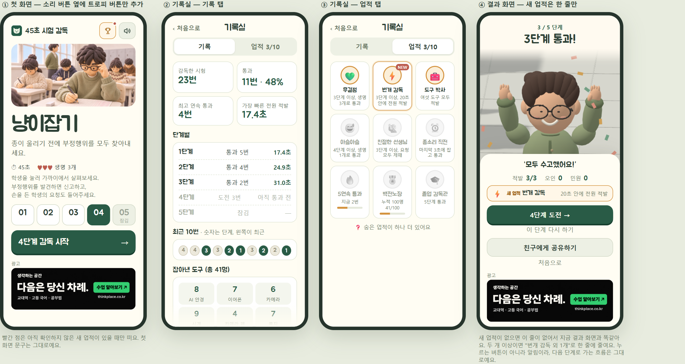

# 기록실 (기록과 업적) 설계

상태: 구현 · 2026-11-18 · 기준 `main` c1c5b33 · 브랜치 `feature/records-achievements`

[목업](../mockups/records-achievements/index.html) · [현재 게임 기획](game-design.md)

## 왜

Vercel 링크로 친구들이 하는 게임이 됐다. 한 판이 45초로 짧고, 5단계를 다 깨면 다시 할 이유가 줄어든다. 내 기록과 업적을 남겨서 "한 판 더" 할 이유를 만든다.

## 목표 / 하지 않는 것

- 목표: 첫 화면의 트로피 버튼으로 여는 '기록실'(기록 탭·업적 탭). 결과 화면에는 새 업적 한 줄.
- 하지 않는 것: 서버·로그인·온라인 순위표(비용 발생), 게임 도중 업적 알림, 첫 화면 성적 문장, 분석 이벤트 추가.
- 실패로 보는 것: 결과 화면이 길어져 다음 단계 버튼이 밀리는 것. 업적 설명이 범인 찾는 힌트가 되는 것. 기존 저장(열린 단계·최근 10판)이 깨지는 것.

## 고려한 안

| 안 | 내용 | 결과 |
| --- | --- | --- |
| A · 따로 보는 기록실 | 트로피 버튼 → 기록/업적 탭 화면. 결과에는 새 업적 한 줄 | **선택** — 첫 화면·결과 화면을 거의 그대로 둔다 (D26 문구 정리와 맞음) |
| B · 첫 화면 요약 | 시작 버튼 아래 기록 4칸·업적 막대 | 제외 — D26에서 없앤 첫 화면 성적 문장을 되살리는 셈 |
| C · 게임 중 알림 | 업적을 따는 순간 알림, 결과에 다음 목표 | 제외 — 관찰을 가리고 D05(진행 중 적발 수 비공개)와 부딪힘 |

## 화면

1. **첫 화면**: 소리 버튼 왼쪽에 트로피 버튼(같은 크기·선 아이콘). 아직 확인하지 않은 새 업적이 있으면 작은 빨간 점. 다른 문구·배치는 그대로.
2. **기록실**: 로비 자리에 열리는 화면. 위에 '‹ 처음으로'와 탭 두 개(기록 / 업적 n/10). Escape와 뒤로 버튼은 첫 화면으로. 작은 가로 화면(568×320)에서는 세로로 스크롤.
   - 기록 탭: 감독한 시험 수, 통과 수·비율, 최고 연속 통과, 가장 빠른 전원 적발 / 단계별 통과 횟수·최단 전원 적발(열리지 않은 단계는 '잠김') / 최근 10번(단계 번호가 적힌 점, 채운 점 = 통과) / 잡아낸 도구 6종 개수 / 오인·민원 합계.
   - 업적 탭: 3열 배지. 딴 것은 색, 못 딴 것은 회색과 조건, 누적 업적은 진행 막대. 숨은 업적은 딸 때까지 "숨은 업적이 하나 더 있어요"로만 표시. 탭을 열면 NEW 표시와 빨간 점을 지운다.
3. **결과 화면**: 적발·오인·민원 줄 바로 아래에 새 업적 한 줄(아이콘 · 새 업적 · 이름 · 짧은 조건). 두 개 이상이면 "이름 외 n개". 누르는 버튼이 아니다. 새 업적이 없으면 지금 결과 화면과 같다.

## 업적 10개

입문용 업적(첫 감독·첫 적발·첫 통과)은 너무 쉬워서 두지 않는다(사용자 결정, 2026-11-18). 실력 업적은 3단계 이상에서만 딸 수 있다.

| id | 이름 | 조건 |
| --- | --- | --- |
| flawless | 무결점 | 3단계 이상을 생명 3개로 통과 |
| lightning | 번개 감독 | 3단계 이상에서 시작 20초 안에 범인 전원 적발하고 통과 |
| close-call | 아슬아슬 | 4단계 이상을 생명 1개로 통과 |
| kind-teacher | 친절한 선생님 | 3단계 이상에서 도움 요청을 모두 마감 전에 돕고 통과 |
| buzzer | 종소리 직전 | 마지막 범인을 남은 3초 안에 잡고 통과 |
| streak-5 | 5연속 통과 | 연속 통과 5번 (단계 무관, 실패하면 0) |
| all-tools | 도구 박사 | 여섯 도구를 각각 1번 이상 적발 (누적) |
| veteran | 백전노장 | 누적 적발 100명 |
| graduate | 졸업 감독관 | 5단계 통과 |
| tears (숨김) | 눈물바다 | 오인 신고 3번으로 실패 |

숫자(단계·20초·3초·5연속·100명)는 첫 제안값이며 플레이 후 조정할 수 있다. 조건 문구에는 도구 구별법을 넣지 않는다.

## 저장

- 새 키 `nyangijapgi.records.v1`에 따로 저장한다. 기존 `nyangijapgi.v2`(열린 단계·최근 10판·소리)는 건드리지 않는다.
- 담는 값: 시험 수, 통과 수, 현재·최고 연속 통과, 단계별 {도전, 통과, 최단 전원 적발}, 도구별 적발 수, 누적 적발·오인·민원, 업적별 딴 시각, 아직 확인하지 않은 업적 목록.
- 처음 만들 때 기존 최근 10판으로 시험·통과·연속·단계별 횟수를 채우고, 거기서 성립하는 업적(졸업 감독관 등)은 NEW 없이 조용히 연다. 누적 적발·오인·민원, 도구별 개수, 시간 기록은 0에서 시작한다(도구 칸과 누적 숫자를 맞추기 위해).
- 저장이 막힌 브라우저에서도 게임은 그대로 되고, 기록실은 이번 접속 동안만 유지된다.

## 바꿀 곳

- `src/session.js` `result()`에 적발한 도구 목록, 마지막 적발 시각, 전원 적발 시각, 요청 수·제때 도운 수를 더한다. 기존 필드 뜻은 바꾸지 않는다.
- 새 `src/records.js`: 업적 목록과 `applyResult(records, result)`(기록 갱신 + 새로 딴 업적 반환), 예전 기록으로 채우기. 화면·저장과 분리된 순수 함수.
- `src/ui.js`: 트로피 버튼, 기록실 화면, 결과의 새 업적 줄. `src/main.js`: 저장·불러오기, `records` 동작, 결과 때 `applyResult`. `src/style.css`.
- 문서: `game-design.md` 진행과 저장, 결정 이력 D27, 현재 검증, 캡처 색인.

## 확인 방법

- `tests/records.test.js`: 업적 조건 각각, 연속 통과 끊김, 예전 기록 채우기, 깨진 저장값.
- `npm test`, `npm run build`, `test:browser`, `test:campaign`.
- 320×568 · 390×844 · 568×320 · 1167×813에서 첫 화면·기록실 두 탭·새 업적이 뜬 결과 화면을 직접 플레이로 확인하고 `docs/playtest/records-achievements/`에 캡처.
- PR 본문에 목업과 실제 캡처를 나란히 싣는다.

## 남겨 둔 판단 (만드는 사람 몫)

- 배지 아이콘은 목업처럼 이모지로 한다(휴대폰마다 모양이 조금 다름). 나중에 선 아이콘으로 바꿀 수 있다.
- 기록실 진입·탭 전환 애니메이션은 넣지 않는다.
