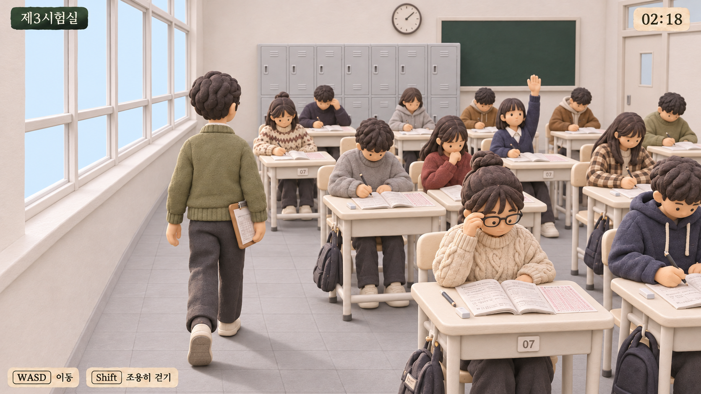

# 냥이잡기

감독관이 되어 수능 시험실을 직접 걷는 3인칭 싱글플레이 웹게임. 휴대폰 터치를 기본으로 하며, 감독 시작을 누르면 12석·2분 시험에 바로 입장한다.



## 한 장면으로 시작하기

남은 시간 1분 18초. 07번이 안경을 고쳐 쓴다. 메모에 시각과 좌석을 남기는 순간, 복도 쪽 학생이 손을 든다. 답안지를 바꿔 달라는 뜻이다. 새 답안지를 가져다주고 그 자리에 서면 07번의 옆모습도 볼 수 있다. 하지만 조금 전에도 그 통로를 왕복했다. 맨 앞 학생은 발소리가 날 때마다 쓰던 손을 멈춘다.

여기서 플레이어가 고르는 것은 **다음 몇 초를 어디에서, 누구를 보며 보낼지**다. 답안지를 건네고 그대로 멈춰 관찰할 수도 있고, 먼저 교탁에서 07번을 더 본 뒤 움직일 수도 있다. 두 선택 모두 적발과 학생 응대를 함께 달성할 여지가 있어야 한다.

## 손으로 빚은 3D 시험실

벽과 책상은 따뜻한 백색, 바닥과 사물함은 연회색으로 잡는다. 흰 창틀 너머는 옅은 하늘색 한 면으로 표현한다. 부드러운 그림자로 가구의 모서리와 통로를 구분하고, 학생의 안경테와 소매에는 조금 더 짙은 색을 써서 손동작이 읽히게 한다.

교실을 걷는 동안 카메라는 감독관의 어깨보다 조금 높은 곳에서 등을 따라간다. 등과 발, 다음에 꺾어 들어갈 책상 사이가 한 화면에 들어온다. 교탁 앞에서 뒷문까지 통로가 이어지고 앞뒤와 가운데 줄에서 옆 통로로 건너갈 수 있다. 책상·의자에는 충돌 범위를 두고, 벽에 가까워지면 카메라만 감독관 쪽으로 당긴다.

학생과 감독관, 책상과 사물함까지 모서리를 둥글린 무광 점토로 만든다. 감독관은 초록 카디건과 옆구리에 든 일지로 알아본다. 학생들은 점처럼 작은 눈, 뭉쳐 빚은 머리칼, 서로 다른 소매 색을 갖는다. 안경을 밀어 올릴 때 소매가 손등에 걸리고, 손을 들 때 연필을 책상에 내려놓는 작은 동작에 성격이 드러난다. 종이 넘기는 소리와 가끔 끊기는 사인펜 소리가 들릴 정도로 교실은 고요하다.

## 화면과 조작

세로 화면 아래에서 왼손은 이동 패드, 오른손은 A를 맡는다. A 옆의 좌석 번호나 장소와 동사가 지금 할 일을 알려 준다. 학생을 탭해 다가간 뒤 A를 눌러 관찰하거나 요청을 듣는다. 관찰 화면에서도 오른쪽 같은 자리에 A가 있어 그 순간의 손동작을 기록할 수 있다. 지목은 일지에서 근거와 유형을 고른 뒤 제출한다.

| 행동 | 조작과 결과 |
| --- | --- |
| 자유롭게 걷기 | 왼쪽 패드를 안쪽 점선까지 밀면 살금살금 걷고, 끝까지 밀면 보통 걸음이 된다. 패드 아래에 현재 걸음이 표시된다. 학생에게 자동으로 다가갈 때는 마지막 몇 걸음에서 속도와 발소리를 줄인다. PC에서는 WASD·방향키와 Shift도 쓸 수 있다. |
| 멈춰 관찰하기 | 학생을 탭해 선택하거나 가까이에서 바라본 뒤 A를 누른다. 손이 가려지면 ‘돌아가기’를 눌러 옆으로 이동한다. |
| 학생 요청에 대응하기 | 손 든 학생과 눈이 마주치면 상호작용으로 고개를 끄덕인다. 교탁으로 걸어가 답안지를 집고 학생 옆에서 건네거나, 창가에서 커튼을 닫는다. 플레이어와 학생의 위치, 시선, 손에 든 물건에 맞춰 가능한 동작을 표시한다. |
| 근거 기록과 지목 | 관찰 중 화면에 보인 행동을 기록할 수 있다. 일지 버튼을 눌러 좌석·유형·근거를 골라 제출한다. 판정이 맞으면 학생이 시험지를 내려놓고 뒷문으로 걸어 나간다. 잘못 지목하면 학생은 시험을 계속하고 오인 기록이 남는다. |

평소 화면에는 시험실 이름과 남은 시간이 보인다. 학생 곁에 가면 아래 버튼에 좌석 번호와 가능한 행동이 뜬다. 손에 든 감독 일지는 필요할 때 펼친다. 시선을 돌려도 감독관의 현재 위치에서 볼 수 있는 행동만 기록된다. 발소리를 끈 경우에는 작은 발자국 표시와 근처 학생의 반응으로 소음의 크기를 읽을 수 있다.


## 사건을 설계하는 방법

아래 단서와 판정은 가상의 시험실에서 읽을 수 있게 만든 연출이다. 실제 수능의 부정행위 유형과 반입 금지 물품은 교육부 안내를 참고하고, 한 판의 시간과 퇴실 처리는 게임에 맞게 압축한다. [교육부 수능 부정행위 안내](https://www.moe.go.kr/sub/infoRenew.do?m=011301&page=011301&s=moe)

| 사건 | 교탁에서 보이는 행동 | 더 보았을 때 갈리는 두 장면 |
| --- | --- | --- |
| AI 안경 | 학생이 안경을 벗었다가 다시 쓴다. | 일반 렌즈의 반사는 고개를 돌리면 창틀 모양대로 움직인다. 가상의 스마트 안경에서는 학생이 벗어 든 렌즈 안쪽에 문항 번호가 바뀌는 작은 화면이 보인다. |
| 초소형 이어폰 | 학생이 한쪽 귀를 만진다. | 머리카락을 넘기고 손을 내리기도 한다. 다른 사건에서는 작은 이어폰을 꺼내 책상 위 충전 케이스에 넣는 순간을 볼 수 있다. |
| 소형 카메라 | 손에 든 물건을 시험지 가까이 가져간다. | 지우개를 가져가 지문 밑줄을 지우는 경우가 있다. 카메라 사건에서는 물건을 내려놓을 때 뒷면 화면에 방금 본 시험지 사진이 남아 있다. |
| 쪽지 | 책상 아래로 떨어진 종이를 주워 펼친다. | 수험표의 사진·수험번호 배열이 드러나거나, 손으로 쓴 문항별 답 목록을 보고 답안지에 옮기는 장면이 이어진다. |

각 사건에는 멀리서도 알아볼 첫 동작, 판단을 바꿀 후속 동작, 놓친 사람이 다시 볼 두 번째 기회를 쓴다. 안경 착용이나 귀를 만지는 습관은 여러 학생에게 배분한다. 같은 점토 인형과 같은 옷차림으로도 다음 판의 사건은 달라진다.

## 민원은 어떻게 플레이가 되는가

- **동선에 이유를 만든다.** 한 번 통로를 지나는 것은 일상적인 감독이다. 학생마다 최근 자기 책상 근처에서 들은 발소리가 쌓인다. 보통 걸음으로 같은 자리를 거듭 지나면 그 학생이 먼저 펜을 멈추고 고개를 든다. 조용한 걸음은 같은 길에서 방해가 덜한 만큼 답안지를 전하는 시간이 길어진다. 이때 멈추거나 다른 쪽을 살피면 민원을 피할 수 있다. 계속 왕복하면 “뒤에서 나는 발소리 때문에 지문을 다시 읽었어요”가 접수된다.
- **접수 후에도 할 일이 있다.** 민원 쪽지에서 위치를 확인하고 교탁에 돌아가거나 해당 통로를 잠시 비운다. 학생이 다시 쓰기 시작하면 일지에 ‘조치 완료’가 찍힌다. 이미 접수된 감점은 남고, 같은 불편이 계속되는 동안에는 중복 접수되지 않는다.
- **손을 든 순간부터 시간을 읽을 수 있다.** 답안지 교체를 요청한 학생에게 고개를 끄덕이면 학생이 손을 내리고 기다린다. 기다림이 길어지면 다시 손을 든다. 그 뒤에도 처리하지 않으면 지연 민원으로 이어진다. 첫 반응과 실제 처리를 나눠 플레이어에게 돌아올 시간을 준다.

## 종이 울린 뒤

게임 중에는 정답이나 점수를 띄우지 않는다. 종료 후 감독 일지에 **적발 수 / 실제 사건 수**, 오인 지목, 접수 민원, 처리한 요청을 보여준다. 빈 책상과 사건이 남았던 책상을 차례로 선택하면 그 학생의 행동 두 컷과 자신의 판단 시점을 비교할 수 있다.

첫 테스트용 점수는 100점에서 **미적발 1건당 15점, 오인 지목 1건당 20점, 접수 민원 1건당 8점**을 뺀다. 최저점은 0점이다. 확증 없이 엉뚱한 학생을 지목하면 오인으로 처리한다. 실제 사건이 있어도 제출한 근거가 맞지 않으면 지목을 기각하고, 그 학생에게서 새 단서를 얻으면 다시 판단할 수 있다. 예를 들어 실제 사건 2건 중 1건을 잡고 오인 없이 민원 1건으로 마치면 **77점**이다. 시범 플레이에서 무작정 지목하거나 교탁에서 계속 기다리는 전략이 유리하면 사건의 재등장 간격과 배점을 조정한다.

## 웹에서 처음 만들 분량

| 순서 | 만들 것 | 확인할 것 |
| --- | --- | --- |
| 1. 2분 한 판 | 1교시 국어, 12석, 통로 세 곳, 사건 네 종류 중 1~3건, 요청 두 종류, 판정·퇴실·민원·복기까지 연결한다. | 같은 사건을 다른 자리에서 경험해도 근거를 찾는가. 필요한 순회 한 번으로 민원이 발생하지 않는가. 오인 사유와 대응 지연을 결과에서 이해하는가. |
| 2. 게스트 웹판 | 첫 화면의 ‘감독 시작’으로 바로 입장한다. WebGL로 교실과 인물을 그린다. 책상과 의자는 같은 모델을 재사용하고, 점토 표면의 눌린 자국과 교실의 고정 그림자는 텍스처에 담는다. 일지와 조작 버튼은 웹 UI로 구현한다. 최근 일지와 최고점은 해당 브라우저에 저장한다. | 새 브라우저에서 가입 없이 한 판을 끝낼 수 있는가. 작은 화면에서 두 엄지로 통로를 돌고 학생 손을 관찰할 수 있는가. 무음으로도 같은 판단을 내릴 수 있는가. |

## 실제로 참고할 게임

| 작품 | 원작의 구체적인 방식 | 냥이잡기에 가져올 설계 |
| --- | --- | --- |
| 튀어나와요 동물의 숲 | A 한 곳에 주민과 대화, 게시판 읽기, 집에 들어가기 등 대상별 행동이 배정돼 있다. [닌텐도 조작표](https://csassets.nintendo.com/noaext/image/private/t_KA_PDF/3DS_Animal_Crossing_New_Leaf_en) | 학생, 교탁, 창가를 같은 상호작용 버튼으로 다룬다. |
| 젤다의 전설 시간의 오카리나 3D | 액션 아이콘에 현재 상황에서 가능한 행동을 표시하고 A로 실행한다. [닌텐도 전자 설명서](https://www.nintendo.com/eu/media/downloads/games_8/emanuals/nintendo_3ds_2/the_legend_of_zelda__ocarina_of_time/ElectronicManual_Nintendo3DS_TheLegendOfZeldaOcarinaOfTime_EN.pdf) | A의 위치는 고정하고 옆에 ‘02번 학생 · 요청 듣기’처럼 대상과 행동을 쓴다. |
| 캐치냥이 | 시험 감독관이 돌아볼 때 수험냥의 카메라·이어폰을 찾아 탭한다. 초기 버전은 AI 안경과 일반 렌즈 반사를 구별했다. [웹게임](https://catchai.devtoolbox.gg/) · [제작자의 초기 버전 소개](https://gall.dcinside.com/board/view/?id=exam_new2&no=1859694&page=1) | 한 장면으로 감독 역할을 이해시키는 입구. 이 기획의 고유한 선택은 단서를 본 뒤의 몇 초, 즉 다른 학생을 돕기 위해 자리를 뜰 것인가에 둔다. |
| EXAM WATCH! | 대학의 시험 감독을 1인칭으로 경험하고, 적발하거나 눈감아 주는 결정이 평판과 경력에 이어진다. [개발사 소개](https://prcgames.com/game) | 개입의 결과가 주변에 보이게 한다. 학생이 조용히 나간 뒤 옆자리 학생이 펜을 멈췄다가 다시 쓰는 짧은 연출을 쓴다. |
| Papers, Please | 입국 심사대에서 자료를 대조하고 누구를 통과시킬지 결정한다. [공식 상점](https://store.steampowered.com/app/239030/Papers_Please/) | 감독 일지를 판단 도구로 쓴다. 관찰한 한 줄을 선택해 판정을 내리고, 종료 후 그 기록을 다시 읽는다. |
| I’m on Observation Duty | 화면을 살피다가 이상 현상의 위치와 종류를 지정해 보고한다. [개발사 상점 소개](https://store.steampowered.com/app/1046820/Im_on_Observation_Duty/) | 첫 수 초에 각 학생의 평소 동작을 익힌다. 이후 달라진 부분을 알아차리면 좌석과 사건 유형을 함께 기록한다. |

<details>
<summary>화이트톤 클레이 화면 시안의 제작 프롬프트 · 내장 ImageGen</summary>

[이전 클레이 시안](exam-room-03-clay.png)을 바탕으로 교실 색감과 창밖 표현을 수정했다.

```text
Edit the supplied 3D clay gameplay screenshot of a quiet Korean exam classroom. Change the environment to a calm, clean white palette and simplify the windows. Preserve the 16:9 composition, player camera, aisle spacing, all student poses and the four original UI labels exactly. Cream-white matte clay walls and desks, pearl-gray floor and lockers, white window frames. The exterior is a single flat, very pale sky-blue color seen through simple window panes, without trees, leaves, branches, buildings, landscape or decorations on the sill. Clean the surfaces of visual clutter. Soft neutral daytime illumination with gentle contact shadows to articulate the three-dimensional clay shapes. The player still wears a subdued sage cardigan; keep dark hair, frames of glasses and enough color in hands and sweater cuffs to read the foreground glasses adjustment and the raised hand behind it. Keep the handmade rounded clay character and the solemn exam mood. No sepia tone, dramatic sunbeams or blown-out highlights.
```

</details>
